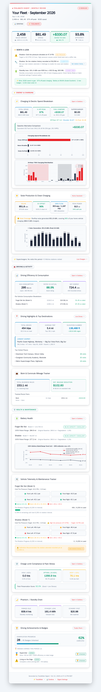

# ⚡ TeslaMate Digest

[](https://www.python.org/)
[](https://www.docker.com/)
[](LICENSE)

A modern, self-hosted Python web application and automated email digest service built on top of your [TeslaMate](https://github.com/teslamate-org/teslamate) telemetry data.

Delivering financial charging clarity, battery health tracking, maintenance monitoring, and celebratory annual retrospectives directly to your inbox.

---

## 📸 Preview



---

## ✨ Features

- **⚡ Charging & Electric Spend Breakdown**: Detailed financial accounting of home charging across Time-of-Use (TOU) tiers (Off-Peak vs. Shoulder vs. On-Peak), Superchargers, and net savings vs. gasoline.
- **🔋 Battery Health & Degradation**: 100% rated range tracking, BMS capacity degradation curves over time, and individual vehicle baselines for multi-car fleets.
- **🛠️ Telemetry & Maintenance**: Visual 4-corner TPMS tire pressure monitoring with color-coded balance alerts, dynamic tire rotation progress bar, and firmware update logs.
- **📍 Driving Highlights & Places**: Tracks your longest road trips, most-visited destinations, mountain elevation gain, and regenerative braking energy recapture.
- **🌙 Phantom / Standby Loss**: Monitors parked sleep efficiency, vampire drain kWh, and idle costs.
- **🏆 Gamification & Year in Review**: 45+ unlockable driving and charging milestone badges plus a celebratory Spotify-style **Year in Review (Wrapped)** retrospective.
- **☀️ Solar & Home Assistant Sync**: Connect with Home Assistant to track solar charging coverage and self-consumption.
- **💻 Interactive Web Dashboard & Previewer**: Clean browser UI on port `8660` with desktop and mobile email simulators, color themes, and one-click test sends.

---

## 🎨 Tesla Paint Themes & Customization

Match your email digest to your garage! TeslaMate Digest includes **12 built-in themes** styled after Tesla's factory paint finishes and design aesthetics:

| Theme | Inspiration / Style | Color Palette & Accents |
| :--- | :--- | :--- |
| **Pearl White** | Multi-Coat White | Crisp light canvas, slate cards, razor-sharp Tesla red accents |
| **Obsidian Black** | Metallic Black | Deep stealth dark mode, graphite layers, emerald & crimson accents |
| **Stealth Gray** | Gunmetal Gray | Dark titanium finish, cold gray tones, vibrant status badges |
| **Ultra Red** | Deep Multi-Coat Candy | High-vividness candy luster, crimson highlights, dark contrast |
| **Quicksilver** | Liquid Metal | Dynamic metallic silver, high-gloss chrome borders, modern typography |
| **Marine Blue** | Deep Blue Metallic | Deep oceanic navy, electric sapphire & cyan accents |
| **Frost Blue** | Glacier Metallic | Light metallic ice blue, silver tones, cool arctic card styling |
| **Midnight Cherry** | European Giga Berlin Paint | Deep European cherry burgundy, rose gold & warm accents |
| **Cybertruck** | Cold-Rolled Stainless | Raw angular aesthetic (0px border-radius), cyber-monospace styling |
| **Cybercab** | Autonomous Robotaxi | Metallic champagne gold, rich bronze, and futuristic dark accents |
| **Eco-Green** | Clean Energy & Sustainability | Natural forest greens, evergreen cards, clean solar styling |
| **Dark Modern** | Minimalist Dark Slate | Ultra-clean dark theme with high-contrast data visualization |

### 🛠️ Create Your Own Themes & Templates

Want a completely personalized look or tailored layout?
- **Interactive Template Builder**: Navigate to `http://<your-server-ip>:8660/builder` to visually customize email layouts. Pick any factory theme as a starter, reorder modules, tweak CSS styling tokens, and preview changes live.
- **Custom Template Files**: Drop your custom Jinja2 templates into `./custom_templates` (mounted to `/app/custom_templates`). The service automatically detects them and makes them selectable in your delivery schedules.
- **Full Telemetry Context**: Custom templates have full access to all aggregated telemetry, including per-drive stats, Home Assistant solar metrics, battery health baselines, and Matplotlib chart objects.

---

## 🚀 Usage

### docker-compose (Recommended)

Simply add the `teslamate-digest` service to your existing TeslaMate `docker-compose.yml`:

```yaml
services:
  teslamate-digest:
    container_name: teslamate-digest
    image: teslamate-digest:latest
    build: .
    restart: unless-stopped
    ports:
      - "8660:8660"
    environment:
      - TZ=America/Denver
      - DATABASE_HOST=database
      - DATABASE_PORT=5432
      - DATABASE_USER=teslamate
      - DATABASE_PASS=your_postgres_password
      - DATABASE_NAME=teslamate
      - GRAFANA_URL=http://grafana:3000
      - DATA_DIR=/app/data
    volumes:
      - ./data:/app/data
      - ./custom_templates:/app/custom_templates
    depends_on:
      - database
```

### docker cli

```bash
docker run -d \
  --name=teslamate-digest \
  -p 8660:8660 \
  -e TZ=America/Denver \
  -e DATABASE_HOST=database \
  -e DATABASE_PORT=5432 \
  -e DATABASE_USER=teslamate \
  -e DATABASE_PASS=your_postgres_password \
  -e DATABASE_NAME=teslamate \
  -e GRAFANA_URL=http://grafana:3000 \
  -e DATA_DIR=/app/data \
  -v /path/to/data:/app/data \
  --restart unless-stopped \
  teslamate-digest:latest
```

---

## ⚙️ Parameters

### Ports

| Port | Description |
| :--- | :--- |
| `8660` | Web UI, Live Previewer, and Settings Dashboard |

### Environment Variables

| Variable | Default | Description |
| :--- | :--- | :--- |
| `DATABASE_HOST` | `database` | Hostname or IP of your TeslaMate PostgreSQL database |
| `DATABASE_PORT` | `5432` | Port of your PostgreSQL database |
| `DATABASE_USER` | `teslamate` | TeslaMate database username |
| `DATABASE_PASS` | `your_postgres_password` | TeslaMate database password |
| `DATABASE_NAME` | `teslamate` | Database name |
| `TZ` | `UTC` | Timezone for reports and schedules (e.g. `America/Denver`, `Europe/London`) |
| `PORT` | `8660` | Application web port inside container |
| `GRAFANA_URL` | `http://grafana:3000` | Optional Grafana URL for deep-linking in emails |
| `DATA_DIR` | `/app/data` | Internal persistent storage directory |
| `WEB_AUTH_USERNAME` | *(Optional)* | HTTP Basic Auth username for web dashboard access |
| `WEB_AUTH_PASSWORD` | *(Optional)* | HTTP Basic Auth password for web dashboard access |

### Volume Mappings

| Volume | Description |
| :--- | :--- |
| `/app/data` | Persistent storage for settings, maintenance records, and dispatch history |
| `/app/custom_templates` | *(Optional)* Directory to mount custom Jinja2 email templates |

---

## 🏁 Getting Started

1. **Access the Dashboard**: Open `http://<your-server-ip>:8660` in your web browser.
2. **Configure Delivery**:
   - Go to **Settings $\rightarrow$ Delivery**.
   - Enter your SMTP credentials (e.g., Gmail with a 16-character [Google App Password](https://myaccount.google.com/apppasswords)) and your recipient email.
   - Click **Send Test Email** to verify your inbox receives the digest.
3. **Configure Electricity Rates**:
   - In **Settings $\rightarrow$ Integrations**, select your utility tariff (Time-of-Use or Tiered/Flat rates) and your local ZIP code for automatic gas price comparisons.
   - *(Optional)* Connect your Home Assistant instance to track solar production and grid flow.
4. **Schedule & Enjoy**:
   - Choose your preferred frequency (Monthly, Semi-Monthly, Weekly, or Daily) and theme.
   - Click **Live Preview** anytime to view your generated reports across desktop and mobile simulator modes!

---

## 🔒 Security

- **Non-Root Execution**: Runs as an unprivileged user (`appuser`, UID `1000`, GID `1000`) with restrictive `0600` file permissions.
- **Zero-Exposure Credentials**: Passwords and access tokens are never reflected back in plaintext and are preserved securely across saves.
- **Optional Native Auth**: Protect your dashboard with `WEB_AUTH_USERNAME` and `WEB_AUTH_PASSWORD` without requiring an upstream reverse proxy.

---

## 🤝 Contributing

Contributions of all kinds are welcome! Whether you are fixing a bug, adding a new analytical metric, building email themes, or contributing with the help of an AI assistant, check out our [Contributing Guide](CONTRIBUTING.md) (AI allowed) and [Agent Guidelines](AGENTS.md).

---

## 📄 License

This project is open-source under the [MIT License](LICENSE).

