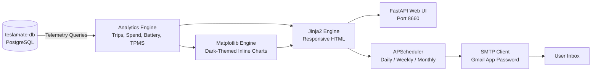

# ⚡ TeslaMate Digest

[](https://opensource.org/licenses/MIT)
[](https://www.python.org/downloads/)
[](https://www.docker.com/)

A modern, automated personal email digest service and annual retrospective built on top of your **TeslaMate** telemetry data.

Delivering utility financial clarity, rich travel storytelling, vehicle telemetry monitoring, and celebratory annual retrospective data badges.

---

## ✨ Features & Modules

### 1. ⚡ Electric Spend & Grid Analytics
* **$ Spend on Charging**: Detailed financial breakdown by location (**Home Off-Peak**, **Home On-Peak**, **Superchargers**, **Public AC**).
* **Time-of-Use (TOU) Engine**: Configure your off-peak and on-peak hours/rates; automatically calculates energy drawn hour-by-hour from the `charges` table.
* **Off-Peak Score**: Shows what percentage of your home charging occurred during optimal overnight grid hours.
* **Gas Savings & Environmental Offset**: Calculates exact money saved compared to fueling a baseline gas vehicle, gallons of gasoline avoided, and pounds of $\text{CO}_2$ prevented.

### 2. 🔋 Battery Health & Degradation Tracker
* **100% Rated Range Estimate**: Tracks capacity trends across charges (e.g. Model X ~286 mi, Model Y ~278 mi).
* **Degradation % & Health Grade**: Calculates capacity retained over time with an automated health grade (*Excellent*, *Good*, *Fair*).
* **High-Res Trendline**: Embeds a 6-month historical trendline directly into the email.

### 3. 📍 Driving Highlights & Places (The Google Maps Module)
* **Top Destinations**: Ranks your most frequently visited spots (using reverse-geocoded addresses and geofences) with visit counts.
* **Longest Journey of the Month**: Highlights your biggest road trip (origin, destination, distance, duration, elevation profile).
* **🏔️ Mountain Elevation & Regen**: Tracks total vertical feet climbed and descended, plus estimates kWh recaptured via regenerative braking on mountain descents.
 
### 4. ⚡ Supercharger Explorer
* **Lifetime Unique Stations Counter**: Keeps track of every distinct Supercharger station you have ever plugged into.
* **New Superchargers Unlocked**: Badges any new station visited during the reporting period with date, peak kW power, and energy added.

### 5. 🛠️ Vehicle Telemetry & Maintenance Tracker
* **4-Corner TPMS Graphic**: Visual tire pressure card (FL, FR, RL, RR in PSI or Bar) with color-coded status (Normal vs. Low vs. Left/Right Imbalance).
* **Tire Rotation Reminder**: Counts miles driven since your last recorded rotation against Tesla's recommended 6,250-mile (10,000 km) interval with a visual progress bar.
* **Firmware Updates**: Logs any new software releases installed on your vehicles during the period.

### 6. 🌙 Vampire / Phantom Standby Loss
* **Sleep Efficiency %**: Tracks hours parked asleep vs. awake/online (Sentry mode, standby polling).
* **Standby Drain Cost**: Calculates estimated kWh and dollars spent on parked idle standby.

### 7. 🎉 Spotify Wrapped "Year in Review" (Annual Retrospective)
* Available on-demand or dispatched on New Year's Day.
* Celebrates your year with driver archetype badges (e.g. *The Night Owl Charger*, *The Peak Bagger*, *The Road Warrior*, *The Wallet Defender*), total miles driven vs. Earth circumnavigations, and yearly top destinations.

### 8. 💻 Interactive Web Dashboard & Live Previewer
* Local web UI running on port **`8660`**.
* **Interactive Live Preview**: Render any past month, week, day, or Year-in-Review directly in your browser with desktop and mobile simulator modes before emailing.
* **One-Click Dispatch**: "Send Test to Inbox" button to test delivery instantly.
* **Maintenance Logger**: Easily update tire rotation dates and odometers with one click.
* **Template Customization**: Supports mounting your own Jinja2 template (`/app/custom_templates/digest.html`) to completely customize the email layout.

---

## 🚀 Quickstart

### Method 1: Add to Existing TeslaMate Stack (Recommended)

Simply add the `teslamate-digest` service to your existing `compose.yaml`:

```yaml
services:
  # ... your existing teslamate, database, grafana, etc ...

  teslamate-digest:
    container_name: teslamate-digest
    image: teslamate-digest:latest
    build:
      context: https://github.com/brombomb/teslamate-digest.git
    restart: unless-stopped
    ports:
      - "8660:8660"
    environment:
      - TZ=UTC
      - DATABASE_HOST=database
      - DATABASE_PORT=5432
      - DATABASE_USER=teslamate
      - DATABASE_PASS=your_postgres_password
      - DATABASE_NAME=teslamate
      - DATA_DIR=/app/data
    volumes:
      - teslamate-digest-data:/app/data
      - ./custom_templates:/app/custom_templates
    depends_on:
      - database

volumes:
  teslamate-digest-data:
```

### Method 2: Standalone Compose (Connecting to External Network)

```yaml
services:
  teslamate-digest:
    container_name: teslamate-digest
    image: teslamate-digest:latest
    build: .
    restart: unless-stopped
    ports:
      - "8660:8660"
    environment:
      - TZ=America/Denver
      - DATABASE_HOST=teslamate-db
      - DATABASE_PORT=5432
      - DATABASE_USER=teslamate
      - DATABASE_PASS=your_postgres_password
      - DATABASE_NAME=teslamate
      - DATA_DIR=/app/data
    volumes:
      - ./data:/app/data
    networks:
      - teslamate_default

networks:
  teslamate_default:
    external: true
```

---

## ⚙️ Configuration & Delivery

Open **`http://<your-server-ip>:8660/settings`** in your browser:

1. **Email Settings**:
   * **SMTP Host**: `smtp.gmail.com`
   * **SMTP Port**: `587`
   * **Username**: `your_email@gmail.com`
   * **Password**: 16-character [Google App Password](https://myaccount.google.com/apppasswords)
   * **Recipient**: `your_email@gmail.com`
2. **Electricity & Rates**:
   * Set your average rate (e.g. `$0.11/kWh`) or configure Off-Peak (e.g. `$0.09`) and On-Peak (e.g. `$0.16`) hours.
   * Customize baseline gas price and ICE vehicle MPG for savings calculations.
3. **Schedule**:
   * Choose **Monthly** (1st of month), **Weekly** (Mondays), or **Daily**.
   * Toggle individual modules on or off as desired.

---

## 🛠️ Architecture



---

## 🔒 Security & Hardening

TeslaMate Digest manages sensitive credentials (SMTP passwords, Home Assistant Long-Lived Access Tokens, Grafana API keys) as well as vehicle telemetry and visit histories. It has been built with defensive security best practices for open-source self-hosting:

### 1. Non-Root Container Execution
The Docker image runs as an unprivileged system user (`appuser`, UID `1000`, GID `1000`) within an isolated virtual environment (`/opt/venv`). It does not require root privileges or Linux capabilities at runtime, making it safe for locked-down NAS environments (Synology, TrueNAS, Unraid).
* **Restricted File Permissions**: Runtime databases (`teslamate_digest.db`) and backups (`config.json`) are strictly written with `chmod 600` permissions under a secure `027` umask.
* **Volume Mount Alignment**: When binding `./data:/app/data`, ensure the directory on your host is owned by UID `1000` (`chown -R 1000:1000 ./data`).

### 2. Reverse Proxy & Authentication
TeslaMate Digest is designed for internal networks. **If exposing the web dashboard outside your trusted local network, always place it behind a reverse proxy (e.g. Caddy, Traefik, Nginx Proxy Manager) with TLS and an authentication layer (Authelia, Authentik, or HTTP Basic Auth).**

#### Example Caddyfile with Authelia Forward Auth:
```caddy
digest.yourdomain.com {
    # Forward auth verification
    forward_auth authelia:9091 {
        uri /api/verify?rd=https://auth.yourdomain.com
        copy_headers Remote-User Remote-Groups Remote-Email
    }

    reverse_proxy teslamate-digest:8660
}
```

#### Example Nginx with HTTP Basic Authentication:
```nginx
server {
    listen 443 ssl http2;
    server_name digest.yourdomain.com;

    ssl_certificate /etc/letsencrypt/live/yourdomain.com/fullchain.pem;
    ssl_certificate_key /etc/letsencrypt/live/yourdomain.com/privkey.pem;

    auth_basic "Restricted Access - TeslaMate Digest";
    auth_basic_user_file /etc/nginx/.htpasswd;

    location / {
        proxy_pass http://teslamate-digest:8660;
        proxy_set_header Host $host;
        proxy_set_header X-Real-IP $remote_addr;
        proxy_set_header X-Forwarded-For $proxy_add_x_forwarded_for;
        proxy_set_header X-Forwarded-Proto $scheme;
    }
}
```

### 3. Secret Isolation
* Keep your `.env` configuration file isolated and unreadable by unauthorized users:
  ```bash
  chmod 600 .env
  ```
* Cleartext passwords are never reflected back into HTML form fields; sensitive fields use masked placeholders and retain existing secrets on empty submission.

---

## 📄 License
This project is open-source under the [MIT License](LICENSE).

