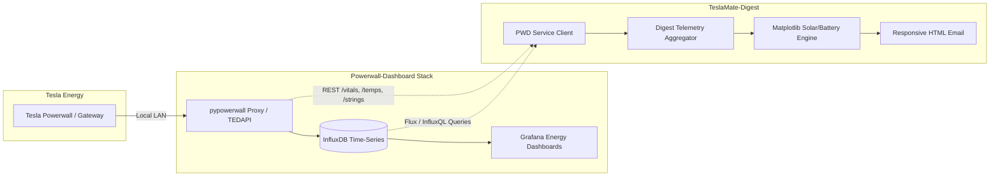

# Feature Requests & Future Integrations

This document tracks planned and requested feature additions for **TeslaMate-Digest**.

---

## ⚡ Feature Request: Powerwall-Dashboard (PWD) Integration

### 1. Overview
Support integration with [Powerwall-Dashboard (PWD)](https://github.com/jasonacox/Powerwall-Dashboard) by Jason Acox, the community-standard Grafana/InfluxDB energy monitoring system for Tesla Powerwall and Solar systems.

While Home Assistant provides excellent high-level energy tracking (daily production, consumption, battery %, and smart automation), Powerwall-Dashboard unlocks deep, hardware-level engineering telemetry that is typically lost or aggregated in standard home automation platforms.

---

### 2. High-Value Capabilities to Extract into Digests

1. **Individual Solar Inverter String Diagnostics (`/strings`)**:
   - Query per-string voltage, current, and wattage (MPPT string 1 vs 2 vs 3).
   - Flag solar string imbalance or shading in the weekly/monthly digest (e.g. "String 2 generated 35% less than String 1 — check for shade, snow accumulation, or failing bypass diodes").

2. **Powerwall Thermal Health & Degradation (`/temps`, `/vitals`)**:
   - Internal battery pack cell temperatures and inverter heat sink temperatures.
   - Temperature extremes report (e.g. max/min battery pack temperatures during summer heatwaves or winter freezes).
   - Individual pack serial number health, state-of-health degradation, and cumulative lifetime cycle counts.

3. **Sub-Second Grid Quality & Phase Harmonics**:
   - Monitor Line A / Line B voltage, frequency stability ($Hz$), reactive power ($VAR$), and apparent power ($VA$).
   - Log dirty power spikes, micro-fluctuations, and grid sags that don't trigger full outages.

4. **Micro-Outage & Islanding Event Log**:
   - Comprehensive tally of grid disconnection / islanding events, backup runtimes, and energy supplied during blackouts.

5. **Multi-Year High-Resolution InfluxDB Time-Series**:
   - Direct InfluxDB connector to pull 5-second power data for high-fidelity charting in digest emails (e.g. overlaying vehicle home charging spikes against live solar production curves).

---

### 3. Proposed Architecture

### 4. Integration Options
- **Option A (Lightweight REST Proxy)**: Query the `pypowerwall` proxy container (`http://powerwall:8675/vitals`, `http://powerwall:8675/temps`, `http://powerwall:8675/strings`) for instant hardware stats without needing database credentials.
- **Option B (Direct InfluxDB Client)**: Query PWD's `influxdb` service for interval-based solar generation, battery round-trip efficiency, and grid power metrics.

---

### 5. Status
- **Current Support**: Home Assistant Energy Integration (Active).
- **PWD Integration**: Under Evaluation / Planned.
