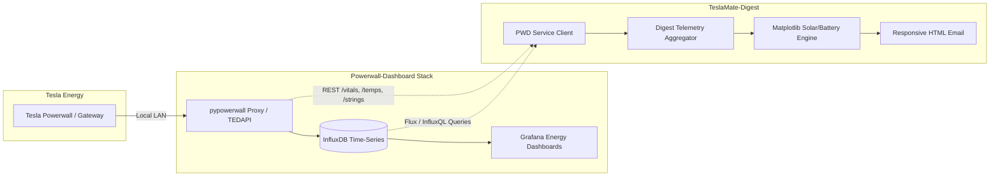
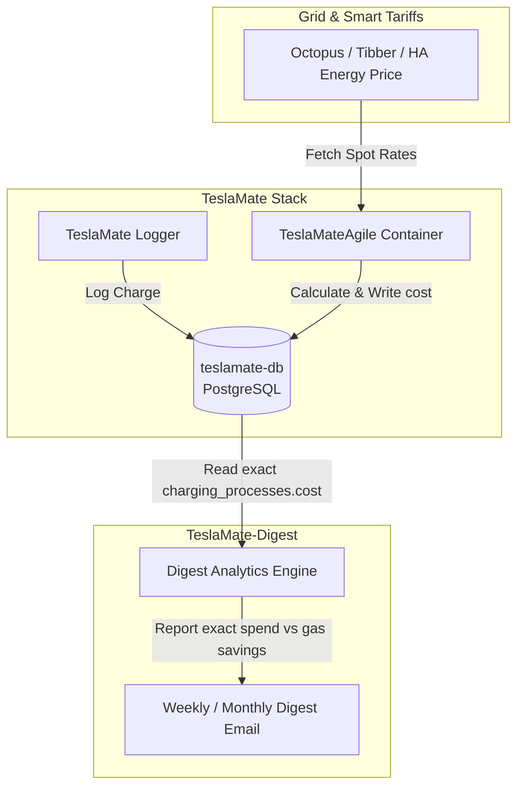
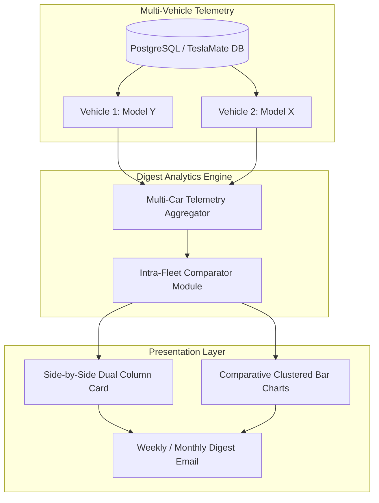
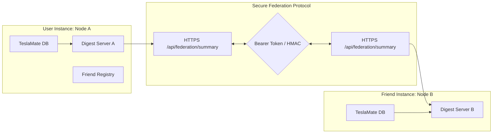
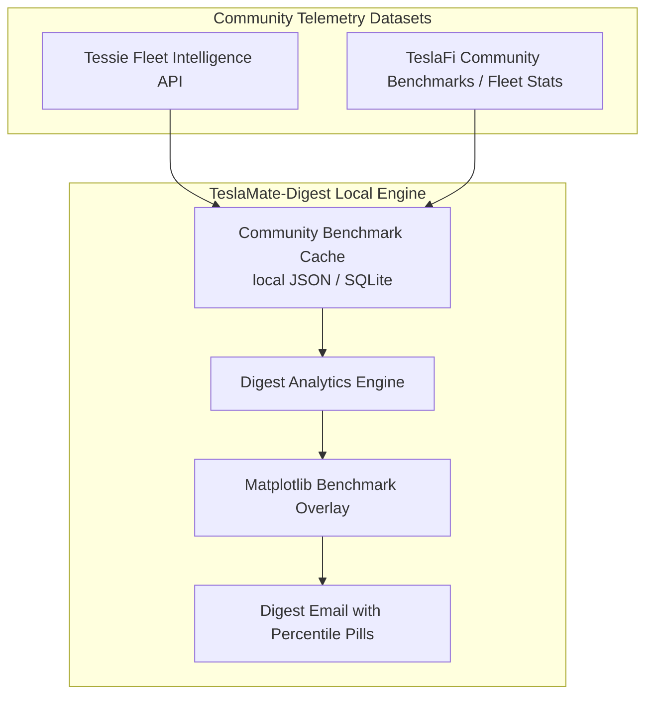
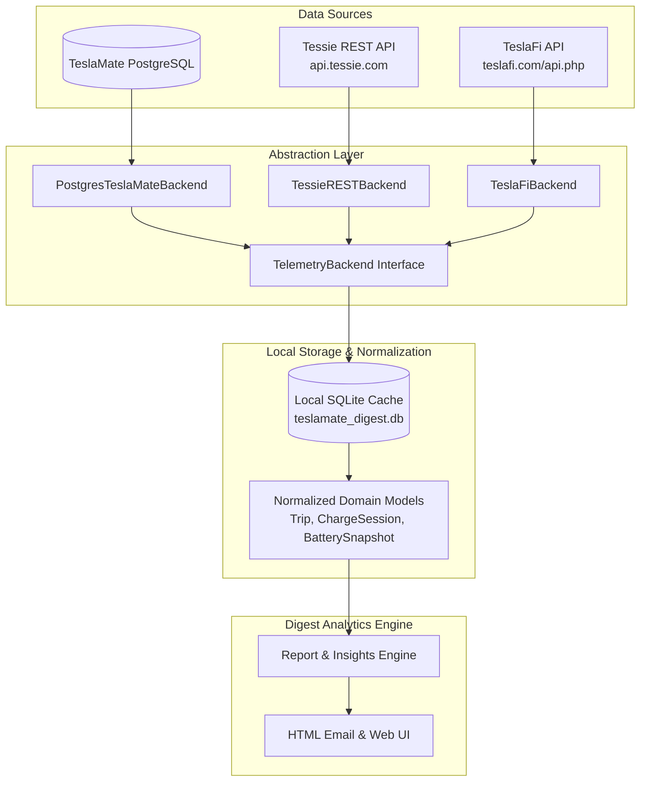

# Feature Requests & Future Integrations

This document tracks planned and requested feature additions for **TeslaMate-Digest**.

---

## ⚡ Feature Request: Powerwall-Dashboard (PWD) Integration

### 1. Overview
Support integration with [Powerwall-Dashboard (PWD)](https://github.com/jasonacox/Powerwall-Dashboard) by Jason Acox, the community-standard Grafana/InfluxDB energy monitoring system for Tesla Powerwall and Solar systems.

While Home Assistant provides excellent high-level energy tracking (daily production, consumption, battery %, and smart automation), Powerwall-Dashboard unlocks deep, hardware-level engineering telemetry that is typically lost or aggregated in standard home automation platforms.

---

### 2. High-Value Capabilities to Extract into Digests

1. **Individual Solar Inverter String Diagnostics (`/strings`)**:
   - Query per-string voltage, current, and wattage (MPPT string 1 vs 2 vs 3).
   - Flag solar string imbalance or shading in the weekly/monthly digest (e.g. "String 2 generated 35% less than String 1 — check for shade, snow accumulation, or failing bypass diodes").

2. **Powerwall Thermal Health & Degradation (`/temps`, `/vitals`)**:
   - Internal battery pack cell temperatures and inverter heat sink temperatures.
   - Temperature extremes report (e.g. max/min battery pack temperatures during summer heatwaves or winter freezes).
   - Individual pack serial number health, state-of-health degradation, and cumulative lifetime cycle counts.

3. **Sub-Second Grid Quality & Phase Harmonics**:
   - Monitor Line A / Line B voltage, frequency stability ($Hz$), reactive power ($VAR$), and apparent power ($VA$).
   - Log dirty power spikes, micro-fluctuations, and grid sags that don't trigger full outages.

4. **Micro-Outage & Islanding Event Log**:
   - Comprehensive tally of grid disconnection / islanding events, backup runtimes, and energy supplied during blackouts.

5. **Multi-Year High-Resolution InfluxDB Time-Series**:
   - Direct InfluxDB connector to pull 5-second power data for high-fidelity charting in digest emails (e.g. overlaying vehicle home charging spikes against live solar production curves).

---

### 3. Proposed Architecture



### 4. Integration Options
- **Option A (Lightweight REST Proxy)**: Query the `pypowerwall` proxy container (`http://powerwall:8675/vitals`, `http://powerwall:8675/temps`, `http://powerwall:8675/strings`) for instant hardware stats without needing database credentials.
- **Option B (Direct InfluxDB Client)**: Query PWD's `influxdb` service for interval-based solar generation, battery round-trip efficiency, and grid power metrics.

---

### 5. Status
- **Current Support**: Home Assistant Energy Integration (Active).
- **PWD Integration**: Under Evaluation / Planned.

---

## ⚡ Feature Request: TeslaMateAgile Dynamic Cost Integration

### 1. Overview
Integrate with [TeslaMateAgile](https://github.com/MattJeanes/TeslaMateAgile) (maintained as [`ghcr.io/amyjeanes/teslamateagile`](https://github.com/AmyJeanes/TeslaMateAgile)), an automated smart cost calculator for TeslaMate charging sessions.

TeslaMate by default relies on static home electricity rates or manually entered charging costs. TeslaMateAgile bridges the gap for dynamic time-of-use (TOU) and half-hourly spot pricing tariffs by automatically polling live energy market APIs and retroactively calculating exact charging costs down to 30-minute intervals, writing the real cost directly into `teslamate.charging_processes.cost`.

---

### 2. Supported Energy Providers & Tariffs
- **Octopus Energy** (Agile Octopus, Octopus Go, Intelligent Octopus Go, Cosy Octopus)
- **Tibber** (Hourly Nord Pool spot pricing + grid fees)
- **aWATTar** (Hourly spot tariffs in Austria & Germany)
- **Nord Pool / Energinet** (Direct day-ahead spot market integration)
- **Pacific Gas & Electric (PG&E)** Day-Ahead Market
- **EDF Tempo** (French blue/white/red peak/off-peak pricing)
- **Monta** (EV charging platform tariffs)
- **Home Assistant Sensor Integration** (Pull dynamic electricity prices directly from an HA price entity)
- **Custom Time-of-Use Fixed Schedules** (Multi-tiered peak / off-peak windows)

---

### 3. How TeslaMateAgile Works with TeslaMate
1. **Event Detection & Geofencing**: TeslaMateAgile listens to TeslaMate MQTT messages or polls PostgreSQL `charging_processes` where `cost IS NULL` and `end_date IS NOT NULL` within a configured geofence (e.g. Home).
2. **Interval Energy Correlation**: It matches the charge timeline (`charges` table) against historical 30-minute or 1-hour energy tariff rates during the exact charging window.
3. **Database Writeback**: It updates `charging_processes.cost` in the PostgreSQL database with the exact calculated monetary amount and currency.

---

### 4. Integration into TeslaMate-Digest



### 5. Benefits for TeslaMate-Digest
- **True Charging Spend**: Digest calculations currently fall back to flat configured $/kWh rates when session costs are null. With TeslaMateAgile active, digest emails display penny-accurate charging expenses, capturing negative pricing events (free/paid-to-charge hours) and peak rate penalties.
- **Dynamic Savings vs. Gas**: Accurately computes true savings compared to gasoline by comparing real fluctuating dynamic electricity spend against local gas prices.
- **Zero Config in Digest**: Because TeslaMateAgile writes directly to `charging_processes.cost`, `teslamate-digest` needs no extra API keys or tariff scrapers—it simply consumes the enriched database column.
- **Status & Recommendation**: Add container definition to the recommended `docker-compose.addon.yml` stack with environment configuration guidelines for Octopus, Tibber, and Home Assistant.

---

## ⚡ Feature Request: Tesla Fleet API & Fleet Telemetry (FSD / Autonomous Driving Tracking)

### 1. Overview
Integrate support for Tesla's official **Fleet API** and self-hosted **Fleet Telemetry** (`tesla/fleet-telemetry`) to enable authoritative Full Self-Driving (FSD / Autopilot) usage tracking and high-frequency push telemetry.

In December 2025, Tesla introduced two dedicated, cryptographically verifiable telemetry signals in Fleet Telemetry for HW4 vehicles:
- `MilesSinceReset`: Total lifetime miles accumulated since odometer/telemetry reset.
- `SelfDrivingMilesSinceReset`: Total miles driven under Full Self-Driving / Autopilot engagement since reset.

This represents the industry's only verifiable and authoritative source of autonomous usage data directly from Tesla vehicles. Standard TeslaMate and legacy Owner API endpoints do not capture Autopilot engagement flags or FSD mileage.

---

### 2. High-Value Capabilities to Extract into Digests

1. **FSD Autonomous vs. Manual Mileage Breakdown**:
   - Total miles driven autonomously on FSD vs. manual human control over the digest window (weekly, monthly, or annual Wrapped).
   - Autonomous Engagement Ratio: e.g. *"78% of your 1,240 miles this month were driven on FSD (Supervised)"*.
   - Month-over-month trend in autonomous driving adoption.

2. **Trip-Level Autonomous Classification**:
   - Classify drives into:
     - 🟢 **100% Autonomous**: Zero manual driver disengagements from departure to destination.
     - 🟡 **Hybrid / Assisted**: Highway or partial route autonomous cruising.
     - ⚪ **Manual**: Traditional human driving.
   - Longest continuous autonomous trip metric (e.g. "Longest Zero-Intervention Journey: 142 miles from Boulder to Breckenridge").

3. **Autonomous Commute Analytics**:
   - Integrate with the *Work & Commute Mileage Tracker* to display what proportion of daily business and commute routes were handled autonomously.

4. **Zero Vampire Drain Architecture (Push vs. Pull)**:
   - In contrast to TeslaMate's REST polling loops, Fleet Telemetry operates via vehicle-initiated mTLS WebSockets. The vehicle connects when driving or charging, and disconnects when sleeping.
   - 100% elimination of logger-induced wakeups or phantom drain risks.

5. **Sub-Second Engineering Telemetry**:
   - Ingest high-resolution motor torque distribution (front vs. rear motor balance), inverter temperatures, and granular HVAC power vs. drivetrain power draws.
   - Local in-vehicle buffering prevents data gaps during cellular dead zones by replaying buffered records upon reconnect.

---

### 3. Proposed Architecture

```mermaid
flowchart TD
    subgraph Tesla Fleet Infrastructure
        CAR[HW4 Tesla Vehicle]
        FLEET_API[Tesla Fleet API Developer Gateway]
    end

    subgraph Telemetry Ingestion Layer
        FT_SRV[Fleet Telemetry Ingest Server\ntesla/fleet-telemetry (Go) or Teslemetry]
        QUEUE[(Pub/Sub / Kafka / Local Webhook)]
    end

    subgraph Data & Storage
        DB[(PostgreSQL / TimescaleDB\nteslamate-db)]
        BRIDGE[Digest Telemetry Bridge / Worker]
    end

    subgraph TeslaMate-Digest
        D_ENGINE[Digest Analytics Engine]
        D_EMAIL[Digest Email with FSD Pillar]
        D_UI[Live Web Preview & Dashboard]
    end

    CAR -->|mTLS Push WebSocket\nSelfDrivingMilesSinceReset| FT_SRV
    CAR -.->|Fleet API Auth / Keys| FLEET_API
    FT_SRV --> QUEUE
    QUEUE --> BRIDGE
    BRIDGE -->|Write FSD intervals| DB
    DB --> D_ENGINE
    D_ENGINE --> D_EMAIL
    D_ENGINE --> D_UI
```

---

### 4. Integration Options for Home & Self-Hosted Users

- **Option A: Managed Proxy (Teslemetry)**:
  - Turnkey integration requiring zero inbound public ports or custom TLS certificates.
  - Teslemetry acts as an official Tesla Fleet API partner, streaming FSD signals directly to local Home Assistant / MQTT / Webhook endpoints.
- **Option B: Self-Hosted `tesla/fleet-telemetry` (Docker Container)**:
  - Run Tesla's open-source Go server (`ghcr.io/tesla/fleet-telemetry`) on local infrastructure.
  - Requires a public domain, Let's Encrypt TLS certificate, and registered public developer key with Tesla.
  - $0 subscription; Tesla provides $10/month in free developer credits which easily covers single and dual-vehicle personal fleets.
- **Option C: Hybrid TeslaMate + Fleet API Gateway**:
  - Keep standard TeslaMate for existing Grafana dashboards while running a lightweight sidecar container that queries the Fleet API for `vehicle_data` telemetry fields and writes FSD stats into an auxiliary PostgreSQL table (`fsd_milestones`).

---

### 5. UI & Email Presentation in TeslaMate-Digest

- **Top KPI Badge**: Display Autonomous % badge alongside Electric Spend and Gas Savings.
- **Dedicated FSD & Autopilot Module**:
  - Horizontal split bar comparing Autonomous Miles vs Manual Miles.
  - Disengagement-free trip tally.
  - FSD safety and comfort score estimation.
- **Status**: Under evaluation / Specification phase.

---

## ⚡ Feature Request: Intra-Fleet Vehicle Side-by-Side Comparison

### 1. Overview
Enable direct comparative head-to-head benchmarking between vehicles in a multi-car household or fleet (e.g. Model Y vs. Model X, or Dual Motor Long Range vs. Performance).

While the standard digest iterates sequentially across vehicles or aggregates fleet totals, intra-fleet side-by-side analysis reveals how driving habits, aerodynamics, vehicle weights, and seasonal weather impact each vehicle's real-world cost and efficiency when operated under the same household environment and electricity tariff.

---

### 2. High-Value Comparative Metrics

1. **Efficiency & Energy Consumption ($Wh/\text{mi}$ or $Wh/\text{km}$)**:
   - Direct efficiency face-off over the digest period.
   - Normalizes consumption across temperature swings (e.g. heating efficiency of heat pump Model Y vs. resistive/older Model S/X).
   - Highlights aerodynamic or tire penalties (e.g. winter tires vs. aero wheels).

2. **Driving & Commute Utilization**:
   - Total miles logged, drive count, highway vs. city split.
   - Longest single drive comparison.
   - Business/work mileage ratio per vehicle.

3. **Charging Economics & Time-of-Use Adherence**:
   - Total kWh drawn and total electric spend.
   - % Off-Peak charging discipline: identify which car is charging during expensive on-peak or shoulder windows.
   - Effective cost per mile ($/mi) for each car.

4. **Battery Health, Range Retention & BMS Drift**:
   - Rated range degradation side-by-side (% retained of factory baseline).
   - Pack preservation score (time spent $>80\%$ and $<20\%$ SoC).
   - Realized range vs. rated range efficiency.

5. **Standby & Phantom Loss Comparison**:
   - Idle loss kWh and daily standby cost side-by-side.
   - Pinpoints parasitic drain culprits (e.g. Sentry Mode active on Car A vs. deep sleep on Car B).

6. **Maintenance & Tire Wear**:
   - Tire rotation odometer progress bars aligned side-by-side.
   - TPMS cold-pressure variances between vehicles.

---

### 3. Proposed Architecture



---

### 4. UI & Email Presentation
- **Dual-Column Side-by-Side Layout**: Responsive 2-column card that stacks gracefully on mobile screens.
- **"Winner" Pill Badges**: Muted green/cyan highlights indicating which vehicle was more efficient, charged more off-peak, or had lower standby loss.
- **Combined Battery Degradation Curves**: Overlaying both vehicles on the same graph with individual vehicle baseline lines.
- **Status**: Planned / Specification phase.

---

## ⚡ Feature Request: "Add a Friend" — Federated Peer-to-Peer Digest Comparison

### 1. Overview
Connect with friends, family, or EV club members who also self-host TeslaMate and TeslaMate-Digest via a secure, decentralized federation protocol.

Instead of locking data behind a centralized proprietary cloud service, two TeslaMate-Digest instances running publicly (via Cloudflare Tunnels, Tailscale Funnel, or reverse proxy with Let's Encrypt) can exchange authenticated, anonymized digest summaries to produce a fun, friendly head-to-head comparison in weekly and monthly emails.

---

### 2. High-Value Comparative Capabilities

1. **Friendly Head-to-Head Scorecard**:
   - **Distance Champion**: Who drove further this week / month?
   - **Efficiency Master**: Who achieved the lowest $Wh/\text{mi}$ ($Wh/\text{km}$)?
   - **Smart Charger**: Who achieved the highest % off-peak charging and lowest $/kWh effective rate?
   - **Gas Saver**: Who saved more net dollars compared to gasoline?

2. **Gamification & Achievement Showdown**:
   - Compare Trophy Room stats: total lifetime badges unlocked (e.g. 23/45 vs 28/45).
   - Highlight badges newly earned by each friend during the current digest window.

3. **Road Trip & Mountain Ascent Face-Off**:
   - Elevation gained (mountain passes climbed).
   - Supercharger stops and charging curve speed comparison.

---

### 3. Privacy-First Federation Architecture

To protect user safety and confidentiality, **no raw GPS data, coordinates, trip timestamps, or geofence names are ever shared across the federation API**. Only high-level mathematical aggregates are exchanged.



#### Federation Endpoint Specification
- **Endpoint**: `GET /api/federation/summary?period=weekly&token=<shared_secret>`
- **Authentication**: Mutual bearer token or pre-shared key configured in Web UI settings.
- **Payload Schema**:
  ```json
  {
    "nickname": "Dave's Model 3",
    "model": "Model 3 Performance",
    "period": "weekly",
    "range": {"start": "2026-10-01", "end": "2026-10-07"},
    "metrics": {
      "total_miles": 342.1,
      "avg_wh_per_mile": 248.0,
      "total_spend": 11.24,
      "off_peak_pct": 98.2,
      "gas_savings": 44.50,
      "elevation_gain_ft": 4200,
      "badges_unlocked": 21,
      "new_badges_count": 1
    }
  }
  ```

---

### 4. User Experience & Configuration
- **Settings UI**: "Friend Network" management panel allowing users to generate public share tokens and add friends' endpoints (`https://teslamate.friend-domain.com`).
- **Digest Email Section**: Optional "👥 Friend Face-Off" card rendered at the bottom of the digest with side-by-side stats and trophy icons.
- **Status**: Under evaluation / Specification phase.

---

## ⚡ Feature Request: TeslaFi & Tessie Individual & Community Benchmark Comparison

### 1. Overview
Benchmark an individual vehicle's performance metrics against global community fleet averages published by major EV telemetry platforms like **TeslaFi** and **Tessie**.

While a single-vehicle owner only has their own history to assess, community platforms aggregate telemetry from tens of thousands of active Tesla vehicles across the globe. Integrating community benchmark data provides essential context: answering whether 274 Wh/mi is exceptional or mediocre for a Model Y in October, and whether a vehicle's battery degradation curve is beating or trailing the fleetwide median.

---

### 2. High-Value Community Benchmarks

1. **Fleet Efficiency Percentile**:
   - Compare vehicle $Wh/\text{mi}$ ($Wh/\text{km}$) against the community distribution for the exact same vehicle model, powertrain, and wheel configuration.
   - Example insight: *"Your Model Y averaged 268 Wh/mi this month, placing you in the **Top 12% (88th percentile)** of most efficient Model Y AWDs."*

2. **Battery Degradation vs. Global Fleet Curve**:
   - Overlay the vehicle's capacity retention against TeslaFi/Tessie global fleet degradation scatter/median curves at identical odometer milestones (e.g. 50k, 75k, 100k miles).
   - Provides reassuring validation that range loss is within normal BMS statistical limits.

3. **Vampire / Standby Drain Benchmarking**:
   - Compare daily standby losses ($kWh/\text{day}$) against the community baseline.
   - Pinpoint whether standby consumption is higher than average due to ambient temperatures, Sentry Mode usage, or background third-party polling.

4. **Supercharging Speed & Curve Benchmarking**:
   - Compare peak charging kW and 10%–80% session duration against fleet averages for identical battery pack chemistries (Panasonic vs. LG vs. CATL LFP).

---

### 3. Proposed Architecture



---

### 4. UI & Email Presentation
- **Percentile Badges**: Add subtle percentile chips next to Efficiency and Battery Health metrics (e.g. `Top 15% Fleetwide 🌟`).
- **Community Curve in Battery Health Chart**: Include faint dashed lines on the Matplotlib battery chart representing the community 10th, 50th (median), and 90th percentile degradation curves.
- **Status**: Under evaluation / Specification phase.

---

## ⚡ Feature Request: Pluggable Data Backends (TeslaFi & Tessie vs. TeslaMate)

### 1. Overview
Decouple **TeslaMate-Digest** from its hard dependency on a local PostgreSQL TeslaMate database by introducing an abstract telemetry backend layer (`TelemetryBackend`).

This allows EV owners who use managed cloud platforms like **Tessie** (via official developer REST API) or **TeslaFi** (via API key / token) to enjoy TeslaMate-Digest's rich, polished email digests, charts, and gamification without needing to set up or maintain a self-hosted Docker, MQTT, and PostgreSQL stack.

---

### 2. Comparison: TeslaMate vs. Tessie vs. TeslaFi Backends

| Dimension | TeslaMate (Current) | Tessie API | TeslaFi API |
| :--- | :--- | :--- | :--- |
| **Hosting Model** | Self-hosted (Docker, PostgreSQL) | Cloud SaaS | Cloud SaaS |
| **Setup Complexity** | High (Docker, MQTT, DB, Networking) | Zero (API Token only) | Low (API Token only) |
| **Data Privacy** | 100% self-hosted & sovereign | Hosted on Tessie servers | Hosted on TeslaFi servers |
| **Hardware / Server Need** | Dedicated Home Server / NAS | Runs anywhere (Docker, Cloud, Pi) | Runs anywhere (Docker, Cloud, Pi) |
| **Data Granularity** | High-frequency streaming | Rich REST API endpoints (`/drives`, `/charges`) | Polled telemetry snapshots |
| **Maintenance Burden** | DB backups, token renewal, schema migrations | None (managed API) | None (managed API) |

---

### 3. Proposed Abstract Architecture



---

### 4. Implementation Details

#### Core Backend Interface
```python
from abc import ABC, abstractmethod
from datetime import datetime
from typing import List, Dict, Any, Optional

class TelemetryBackend(ABC):
    @abstractmethod
    async def get_vehicles(self) -> List[Dict[str, Any]]:
        """Return list of vehicles registered in the account."""
        pass

    @abstractmethod
    async def get_trips(self, car_id: int, start: datetime, end: datetime) -> List[Dict[str, Any]]:
        """Return trip records within date range normalized to standard schema."""
        pass

    @abstractmethod
    async def get_charging_sessions(self, car_id: int, start: datetime, end: datetime) -> List[Dict[str, Any]]:
        """Return charging sessions with kWh, durations, locations, and costs."""
        pass

    @abstractmethod
    async def get_battery_health(self, car_id: int, as_of: datetime) -> Dict[str, Any]:
        """Return battery capacity, degradation, and historical trend series."""
        pass

    @abstractmethod
    async def get_vehicle_status(self, car_id: int) -> Dict[str, Any]:
        """Return current odometer, TPMS pressures, firmware version, and active alerts."""
        pass
```

#### Benefits
- **Broadens Community Adoption**: Allows thousands of Tessie and TeslaFi subscribers to use TeslaMate-Digest instantly by pasting an API token into settings.
- **Migration Flexibility**: Users transitioning from TeslaFi/Tessie to self-hosted TeslaMate (or vice versa) can preserve their digest history seamlessly.
- **Status**: Under evaluation / Architectural design phase.

---

## ⚡ Feature Request: Reorderable Active Modules & Dynamic Template Mapping

### 1. Overview
Allow users to dynamically reorder Active Modules in the Web UI (**Settings** and **Template Builder**) and map that custom order dynamically into email and preview templates.

Currently, while users can toggle individual modules ON or OFF, the rendering sequence in the HTML digest email (`app/templates/email/digest.html`) is hardcoded in a static vertical sequence. Users cannot prioritize high-impact sections (such as placing **Battery Health**, **Work Mileage**, or **Driving Efficiency** at the top ahead of Charging Spend).

This feature introduces interactive reordering controls (drag-and-drop and up/down position controls), persists the ordered module list in `AppConfig` and SQLite, and decomposes monolithic Jinja2 email templates into modular section components that are dynamically rendered in user-configured sequence.

---

### 2. Core Capabilities & User Experience

1. **Interactive Reordering in Web UI**:
   - **Settings Dashboard (`/settings`)**: Draggable module cards under "Active Modules & Sections" with grip handles, position badges, and accessibility up/down arrow buttons.
   - **Template Builder (`/builder`)**: Reorder modules directly in the visual builder with live side-by-side preview updates.
   - **One-Click Reset**: Reset button to quickly restore canonical default order.
   - **Unified Toggle & Order**: Enable/disable checkboxes directly alongside reordering controls.

2. **Per-Schedule Module Customization**:
   - Global default module sequence configured in Delivery settings.
   - Optional custom module ordering per automated schedule (e.g. a "Work Tax Log" schedule orders Work Mileage first; a "Monthly Health" schedule orders Battery Health & TPMS first).

3. **Dynamic Template Decomposition**:
   - Monolithic email templates refactored into clean modular components under `app/templates/email/modules/`.
   - Dynamic Jinja2 dispatch loop that renders active modules in the exact sequence specified by the user's configuration.
   - Strict backward compatibility: Any unlisted or newly added future modules gracefully append in canonical order.

---

### 3. Proposed Architecture

```mermaid
flowchart TD
    subgraph User Configuration
        UI[Settings / Template Builder UI\nDrag-and-Drop Module List]
        SAVE[POST /settings or /builder]
        CONF[AppConfig.modules.order: List[str]]
        DB[(Local SQLite Storage)]
    end

    subgraph Report Engine
        GEN[build_digest_report]
        CTX[Report Context\ncar, rates, battery, efficiency, solar]
        DISP[Dynamic Module Sequence Resolver]
    end

    subgraph Template Rendering
        TPL[digest.html Root Wrapper]
        LOOP["for mod_id in resolved_module_order"]
        M1[modules/spend_breakdown.html]
        M2[modules/battery_health.html]
        M3[modules/work_mileage.html]
        M4[modules/driving_efficiency.html]
        M5[modules/achievements.html]
        OUT[Rendered HTML Email / Live Preview]
    end

    UI --> SAVE
    SAVE --> CONF
    CONF --> DB
    CONF --> DISP
    GEN --> CTX
    CTX & DISP --> TPL
    TPL --> LOOP
    LOOP --> M1 & M2 & M3 & M4 & M5
    M1 & M2 & M3 & M4 & M5 --> OUT
```

---

### 4. Implementation Details

#### 1. Configuration Model
```python
DEFAULT_MODULE_ORDER: List[str] = [
    "spend_breakdown",
    "gas_savings",
    "solar_production",
    "supercharger_explorer",
    "driving_efficiency",
    "top_locations",
    "driving_milestones",
    "work_mileage",
    "battery_health",
    "maintenance_alerts",
    "charge_limit_compliance",
    "vampire_drain",
    "achievements",
]

class ModuleToggles(BaseModel):
    # Existing booleans
    spend_breakdown: bool = True
    gas_savings: bool = True
    battery_health: bool = True
    driving_efficiency: bool = True
    charge_limit_compliance: bool = True
    work_mileage: bool = True
    supercharger_explorer: bool = True
    top_locations: bool = True
    driving_milestones: bool = True
    mountain_regen: bool = True
    vampire_drain: bool = True
    maintenance_alerts: bool = True
    snow_tire_reminder: bool = True
    embedded_charts: bool = True
    solar_production: bool = True
    achievements: bool = True

    # User-defined layout sequence
    order: List[str] = Field(default_factory=lambda: list(DEFAULT_MODULE_ORDER))

    def get_ordered_active_modules(self) -> List[str]:
        """Return active module identifiers sorted by user order, appending any omitted modules."""
        seen = set()
        result = []
        # Add user-ordered modules if enabled
        for mod_id in self.order:
            if getattr(self, mod_id, False) and mod_id not in seen:
                result.append(mod_id)
                seen.add(mod_id)
        # Append any enabled modules missing from order list (future proofing)
        for mod_id in DEFAULT_MODULE_ORDER:
            if getattr(self, mod_id, False) and mod_id not in seen:
                result.append(mod_id)
                seen.add(mod_id)
        return result
```

#### 2. Modular Template Structure
Decompose `app/templates/email/digest.html` into modular partials:
```
app/templates/email/
├── digest.html                     # Root email wrapper, header, car loop, footer
└── modules/
    ├── spend_breakdown.html        # Charging & TOU spend card
    ├── gas_savings.html            # Fuel parity comparison & CO2 savings
    ├── solar_production.html       # Home Assistant solar self-consumption
    ├── supercharger_explorer.html  # Supercharger visits & lifetime map pins
    ├── driving_efficiency.html     # Wh/mi consumption & driving breakdown
    ├── top_locations.html          # Most visited destinations
    ├── driving_milestones.html     # Longest trips & elevation records
    ├── work_mileage.html           # Business commute & IRS tax deduction log
    ├── battery_health.html         # Degradation curve & 100% rated range
    ├── maintenance_alerts.html     # TPMS tire pressures & rotation bar
    ├── charge_limit_compliance.html# Battery stress & SoC limit discipline
    ├── vampire_drain.html          # Sentry mode & standby kWh loss
    └── achievements.html           # Gamified driving badges & milestone unlocks
```

#### 3. Dynamic Template Mapping Dispatcher
In `app/templates/email/digest.html`:
```jinja2
<!-- DYNAMIC MODULE LOOP -->

  
    
  
    
  
    
  
    
  
    
  
    
  
    
  
    
  
    
  
    
  
    
  
    
  
    
  

```

#### 4. Frontend Drag-and-Drop Controls
- Draggable items with touch support and intuitive handles:
```html
<div id="module-sortable-list" class="space-y-2">
  <div class="module-sort-row flex items-center justify-between p-3 bg-white dark:bg-slate-900 rounded-lg border border-slate-200 dark:border-slate-800" draggable="true" data-id="spend_breakdown">
    <div class="flex items-center gap-3">
      <span class="cursor-grab text-slate-400 hover:text-slate-600">☰</span>
      <input type="checkbox" name="mod_spend_breakdown" checked class="rounded text-tesla">
      <span class="text-xs font-bold text-slate-800 dark:text-slate-200">⚡ Charging & Electric Spend Breakdown</span>
    </div>
    <div class="flex items-center gap-1">
      <button type="button" onclick="moveModuleUp(this)" class="p-1 text-slate-400 hover:text-slate-600 text-xs">▲</button>
      <button type="button" onclick="moveModuleDown(this)" class="p-1 text-slate-400 hover:text-slate-600 text-xs">▼</button>
    </div>
  </div>
</div>
<input type="hidden" name="modules_order_json" id="modules_order_json" value="">
```

---

### 5. Benefits & Roadmap
- **Hyper-Personalized Digests**: Commuters can surface work miles at the top; road-trippers can surface supercharging & efficiency; fleet managers can surface battery preservation and maintenance.
- **Component Reusability**: Transforms templates from large monolithic files into clean, maintainable modular components that community members can easily theme, extend, or share.
- **Template Builder Synergy**: Powers an intuitive visual WYSIWYG block reordering experience.
- **Status**: Under evaluation / Architectural design phase.


