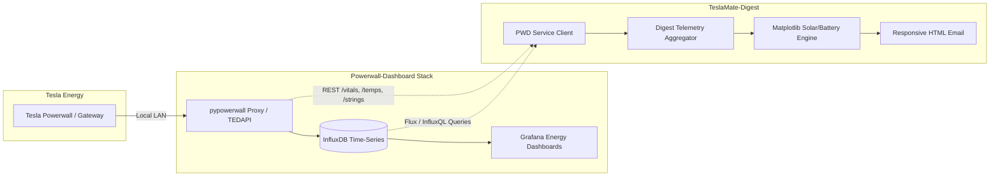
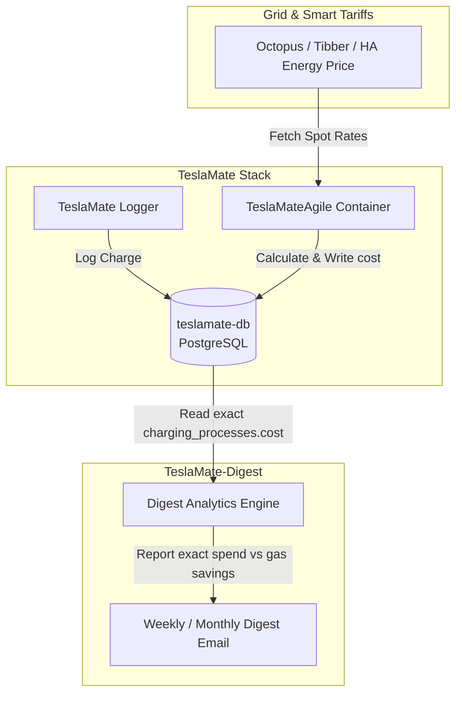

# Feature Requests & Future Integrations

This document tracks planned and requested feature additions for **TeslaMate-Digest**.

---

## ⚡ Feature Request: Powerwall-Dashboard (PWD) Integration

### 1. Overview
Support integration with [Powerwall-Dashboard (PWD)](https://github.com/jasonacox/Powerwall-Dashboard) by Jason Acox, the community-standard Grafana/InfluxDB energy monitoring system for Tesla Powerwall and Solar systems.

While Home Assistant provides excellent high-level energy tracking (daily production, consumption, battery %, and smart automation), Powerwall-Dashboard unlocks deep, hardware-level engineering telemetry that is typically lost or aggregated in standard home automation platforms.

---

### 2. High-Value Capabilities to Extract into Digests

1. **Individual Solar Inverter String Diagnostics (`/strings`)**:
   - Query per-string voltage, current, and wattage (MPPT string 1 vs 2 vs 3).
   - Flag solar string imbalance or shading in the weekly/monthly digest (e.g. "String 2 generated 35% less than String 1 — check for shade, snow accumulation, or failing bypass diodes").

2. **Powerwall Thermal Health & Degradation (`/temps`, `/vitals`)**:
   - Internal battery pack cell temperatures and inverter heat sink temperatures.
   - Temperature extremes report (e.g. max/min battery pack temperatures during summer heatwaves or winter freezes).
   - Individual pack serial number health, state-of-health degradation, and cumulative lifetime cycle counts.

3. **Sub-Second Grid Quality & Phase Harmonics**:
   - Monitor Line A / Line B voltage, frequency stability ($Hz$), reactive power ($VAR$), and apparent power ($VA$).
   - Log dirty power spikes, micro-fluctuations, and grid sags that don't trigger full outages.

4. **Micro-Outage & Islanding Event Log**:
   - Comprehensive tally of grid disconnection / islanding events, backup runtimes, and energy supplied during blackouts.

5. **Multi-Year High-Resolution InfluxDB Time-Series**:
   - Direct InfluxDB connector to pull 5-second power data for high-fidelity charting in digest emails (e.g. overlaying vehicle home charging spikes against live solar production curves).

---

### 3. Proposed Architecture

### 4. Integration Options
- **Option A (Lightweight REST Proxy)**: Query the `pypowerwall` proxy container (`http://powerwall:8675/vitals`, `http://powerwall:8675/temps`, `http://powerwall:8675/strings`) for instant hardware stats without needing database credentials.
- **Option B (Direct InfluxDB Client)**: Query PWD's `influxdb` service for interval-based solar generation, battery round-trip efficiency, and grid power metrics.

---

### 5. Status
- **Current Support**: Home Assistant Energy Integration (Active).
- **PWD Integration**: Under Evaluation / Planned.

---

## ⚡ Feature Request: TeslaMateAgile Dynamic Cost Integration

### 1. Overview
Integrate with [TeslaMateAgile](https://github.com/MattJeanes/TeslaMateAgile) (maintained as [`ghcr.io/amyjeanes/teslamateagile`](https://github.com/AmyJeanes/TeslaMateAgile)), an automated smart cost calculator for TeslaMate charging sessions.

TeslaMate by default relies on static home electricity rates or manually entered charging costs. TeslaMateAgile bridges the gap for dynamic time-of-use (TOU) and half-hourly spot pricing tariffs by automatically polling live energy market APIs and retroactively calculating exact charging costs down to 30-minute intervals, writing the real cost directly into `teslamate.charging_processes.cost`.

---

### 2. Supported Energy Providers & Tariffs
- **Octopus Energy** (Agile Octopus, Octopus Go, Intelligent Octopus Go, Cosy Octopus)
- **Tibber** (Hourly Nord Pool spot pricing + grid fees)
- **aWATTar** (Hourly spot tariffs in Austria & Germany)
- **Nord Pool / Energinet** (Direct day-ahead spot market integration)
- **Pacific Gas & Electric (PG&E)** Day-Ahead Market
- **EDF Tempo** (French blue/white/red peak/off-peak pricing)
- **Monta** (EV charging platform tariffs)
- **Home Assistant Sensor Integration** (Pull dynamic electricity prices directly from an HA price entity)
- **Custom Time-of-Use Fixed Schedules** (Multi-tiered peak / off-peak windows)

---

### 3. How TeslaMateAgile Works with TeslaMate
1. **Event Detection & Geofencing**: TeslaMateAgile listens to TeslaMate MQTT messages or polls PostgreSQL `charging_processes` where `cost IS NULL` and `end_date IS NOT NULL` within a configured geofence (e.g. Home).
2. **Interval Energy Correlation**: It matches the charge timeline (`charges` table) against historical 30-minute or 1-hour energy tariff rates during the exact charging window.
3. **Database Writeback**: It updates `charging_processes.cost` in the PostgreSQL database with the exact calculated monetary amount and currency.

---

### 4. Integration into TeslaMate-Digest

### 5. Benefits for TeslaMate-Digest
- **True Charging Spend**: Digest calculations currently fall back to flat configured $/kWh rates when session costs are null. With TeslaMateAgile active, digest emails display penny-accurate charging expenses, capturing negative pricing events (free/paid-to-charge hours) and peak rate penalties.
- **Dynamic Savings vs. Gas**: Accurately computes true savings compared to gasoline by comparing real fluctuating dynamic electricity spend against local gas prices.
- **Zero Config in Digest**: Because TeslaMateAgile writes directly to `charging_processes.cost`, `teslamate-digest` needs no extra API keys or tariff scrapers—it simply consumes the enriched database column.
- **Status & Recommendation**: Add container definition to the recommended `docker-compose.addon.yml` stack with environment configuration guidelines for Octopus, Tibber, and Home Assistant.

